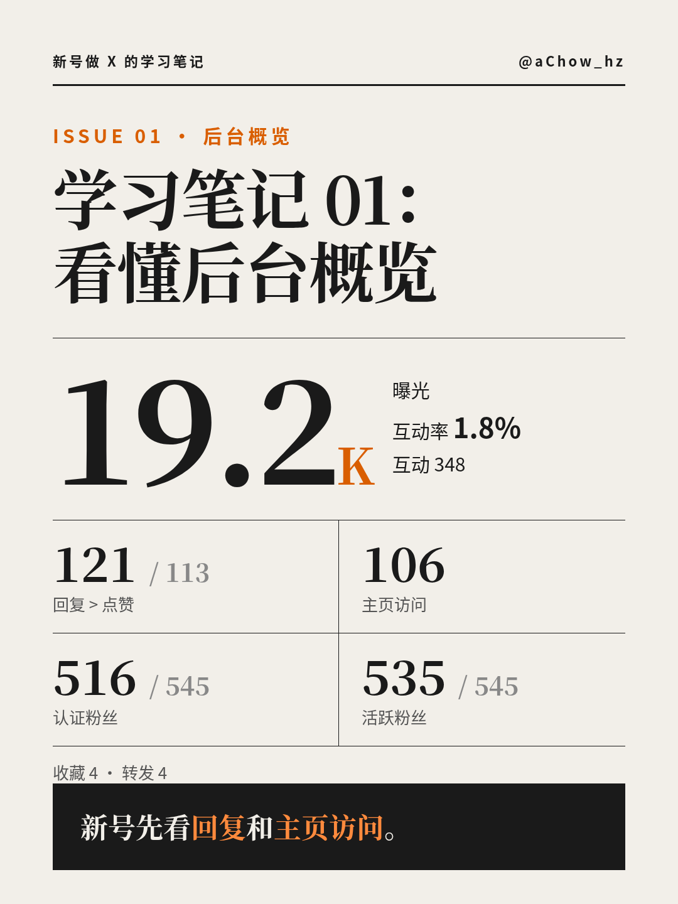
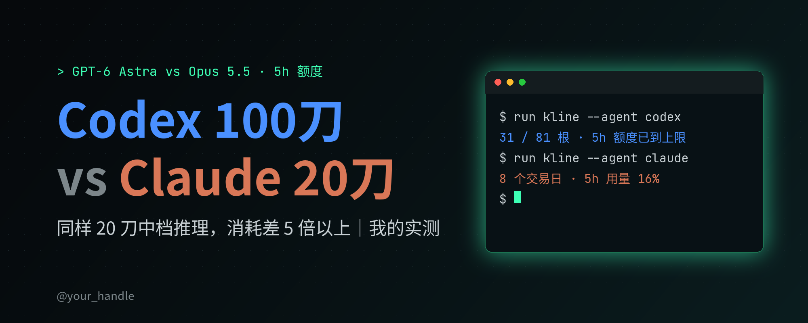

# achow-media-kit · 自媒体制作工具箱

Engineer × AI 工具 × 创作的自媒体制作工具箱：写稿、去 AI 味、出卡片、做封面、做讲解视频，7 个可直接给 Claude Code / Codex 等 Agent 使用的 Skill。

## 目录

| 分类 | Skill | 一句话 | 预览 |
|---|---|---|---|
| 写稿 | [humanizer-zh](skills/humanizer-zh) | 中文去 AI 味：删空话、模板句、四字堆砌，保留事实和作者声音（基于 op7418/Humanizer-zh 改造） | — |
| 写稿 | [anti-vibe-writing](skills/anti-vibe-writing) | 中英文终稿润色：去咨询腔、markdown 脚手架和 AI 标点痕迹，含 X 短帖默认设置 | — |
| 卡片 | [achow-editorial-card](skills/achow-editorial-card) | 杂志风 3:4 数据卡：暖灰纸底、宋体大标题、橙色点缀 |  |
| 卡片 | [achow-glass-card](skills/achow-glass-card) | 毛玻璃数据面板 3:4 卡：柔光渐变、半透明卡片、进度条 |  |
| 卡片 | [achow-journal-card](skills/achow-journal-card) | 手帐笔记风 3:4 卡：方格纸、胶带标签、彩色描边色块 |  |
| 视频 | [achow-explainer-video](skills/achow-explainer-video) | 知识讲解类视频：模拟数据重建后台页面，3D 一镜到底逐项高亮讲解，卡通主讲人 + 配音字幕 + BGM 闪避音效，1080×1920 |  |
| 封面/数据图 | [dark-tech-social-cards](skills/dark-tech-social-cards) | 5:2 封面 + A vs B 柱状对比卡，深色科技 / 亮色教程两套主题 |  |

## 安装

整个仓库（全部 7 个）：
```bash
git clone https://github.com/RichardChow/achow-media-kit ~/achow-media-kit
mkdir -p ~/.claude/skills && cp -r ~/achow-media-kit/skills/* ~/.claude/skills/
```

只装一个（例如杂志风卡片）：
```bash
git clone --depth 1 https://github.com/RichardChow/achow-media-kit /tmp/amk
cp -r /tmp/amk/skills/achow-editorial-card ~/.claude/skills/
```

依赖：
- 卡片类：Node 18+，在 skill 目录里 `npm install`，本机 Chrome/Chromium（自动探测，或设 `CHROME_PATH`）
- 封面类：Python 3.9+，`pip install pillow numpy`
- 视频类：Node 18+（templates 里 `npm install`）、Chrome、Python 3.9+（`pip install numpy edge-tts pillow`）、ffmpeg
- 字体：Noto Sans/Serif CJK（Linux `apt install fonts-noto-cjk`）

### 一句话发给 AI 的安装话术
> 帮我安装这个 Skill 合集：https://github.com/RichardChow/achow-media-kit 。把 skills/ 下每个文件夹复制到 ~/.claude/skills/，卡片类 skill 进目录执行 npm install，封面类装好 pillow 和 numpy，确认本机有 Noto CJK 字体和 Chrome，最后用每个 skill 的 examples 渲染一张图给我看。

## 工作流

```
写稿（自己写/AI 起草）
  → 去 AI 味（humanizer-zh 中文 / anti-vibe-writing 中英）
  → 出卡片（editorial / glass / journal 三选一，JSON 填真实数据 → PNG）
  → 做封面（dark-tech-social-cards：5:2 封面 + 数据对比图）
  → 做讲解视频（achow-explainer-video：script.json + page.html → 竖版视频）
  → 人工看图 QA → 发布
```

原则：数字只用真实数据；每张图渲染后都要人眼检查溢出、小字、缺字。

## Roadmap
- [ ] 小红书多图轮播：一份 JSON 批量出封面 + 内页
- [x] 竖版知识讲解视频（achow-explainer-video）
- [ ] 卡片转竖版动效视频
- [ ] 后台截图自动提取数据 → 直接生成卡片 JSON
- [ ] 更多卡片风格

## License
MIT © 2026 aChow_hz。第三方来源与许可见 [CREDITS.md](CREDITS.md)。
